# Typecraft — interface manual

English · [Русский](Manual.ru.md)

This manual describes the **Typecraft** window and walks through it by task: add a string, translate it,
decorate it, pull a table from Google Sheets, build a font, draw a dialogue. For code and extending
the package see [`API.en.md`](API.en.md); the short reference is [`README.md`](../README.md).

The window UI is in Russian, so button names are given as they appear on screen, with a translation
in parentheses on first use. All screenshots come from the **Showcase** demo sample
(see ["Showcase demo sample"](#showcase-demo-sample)): import it and every button and data row in this
manual is within reach.

## Contents

0. [Installation and the Welcome window](#0-installation-and-the-welcome-window)
1. [Window overview](#1-window-overview)
2. [Editor tab](#2-editor-tab)
3. [Localization tab](#3-localization-tab)
4. [Library tab](#4-library-tab)
5. [Fonts tab](#5-fonts-tab)
6. [Dialogues tab](#6-dialogues-tab)
7. [Showcase demo sample](#showcase-demo-sample)
8. [Troubleshooting](#8-troubleshooting)

---

## 0. Installation and the Welcome window

1. Put `com.velsi.typecraft-0.2.0.tgz` into the project's `Packages/` folder.
2. `Window → Package Manager → + → Install package from tarball…` → pick the file.
3. Wait for the recompile. Typecraft installs TMP Essential Resources, TMPEffects (from the copy bundled
   in the package, no internet needed) and the TMPEffects resources, then opens the **Welcome** window.

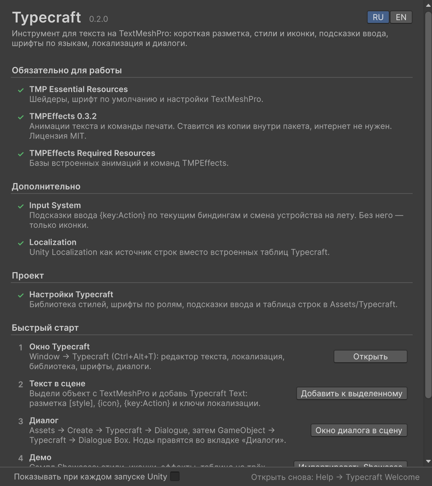

The screenshot shows the Russian UI; switch to English with **EN** in the top right.

- **Required** — ✓ installed, ✗ missing; a missing item has an Install or Import button. At the top:
  what was installed automatically, an install in progress and the error, if any.
- **Optional** — Input System (input prompts from bindings) and Localization (Unity Localization as
  the string source) install with a button.
- **Project** — Create sets up Typecraft settings in `Assets/Typecraft`.
- **Quick start** — open the Typecraft window, add Typecraft Text to the selected TMP, put a dialogue
  box into the scene, import the Showcase sample.
- **Documentation** — the manual and API in the chosen language, art rules.
- **RU / EN** — window language; the checkbox at the bottom shows the window every time Unity starts.

The window opens by itself on first install and after a version upgrade; manually —
`Help → Typecraft Welcome` or `Tools → Typecraft → Welcome`.

---

## 1. Window overview

Open it with `Window → Typecraft` (Ctrl+Alt+T) or `Tools/Typecraft/Open Window`. Five tabs sit at
the top; the window can be docked like any Unity tab (minimum size 420×360, comfortable from 1400 px wide).

| Tab | What it is for |
| --- | --- |
| **✎ Редактор** (Editor) | Editing the markup of one text: highlighting, live preview, a gallery of styles, icons and effects |
| **⇄ Локализация** (Localization) | The key × language grid: translation, checks, sync with Google Sheets, Excel and CSV, export |
| **◆ Библиотека** (Library) | Icon sets, styles, material presets, custom effects |
| **F Шрифты** (Fonts) | A font per role and language, glyph coverage, static font builder |
| **☰ Диалоги** (Dialogues) | Dialogue graph, node inspector, playback without Play Mode, checks |

Good to know first:

- The **table** holds the words for translators. The **markup layer** holds the decoration (`[style]`, `<tag>`)
  on top of it. If the words in the table change after the decoration was made, the decoration stops
  applying and the cell is marked ⚠. More in [README → "Markup layer"](../README.md).
- The window edits project assets. Most edits can be undone with Ctrl+Z; exceptions are noted in
  the text (renaming a style or an icon saves scenes and prefabs immediately).
- Live effects (`<wave>`, `<shake>`, the typewriter) need TMPEffects; button glyphs `{key:Interact}` need the Input System.

---

## 2. Editor tab

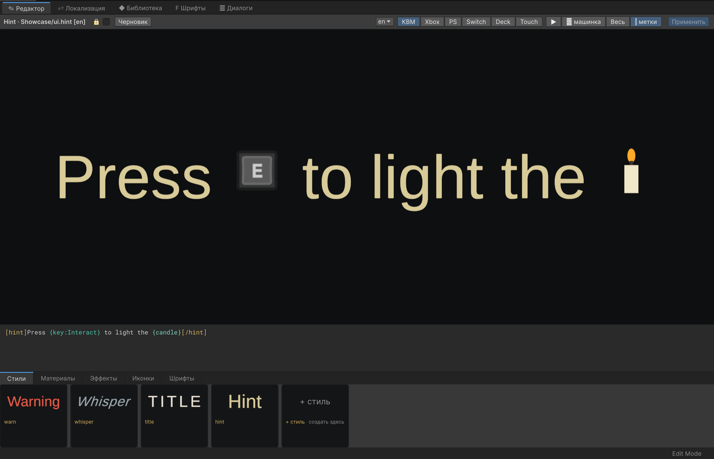

Top to bottom:

1. **Toolbar.** On the left — what is being edited (`Hint · Showcase/ui.hint [en]`: object, table, key,
   language), the 🔒 lock ("do not switch to the selected object") and the **Черновик** (Draft) button — free
   text without an object. On the right — preview language, device (**KBM / Xbox / PS / Switch / Deck / Touch**,
   which decides the `{key:…}` glyphs), ❚❚/▶ — TMPEffects animation, **машинка** (typewriter) / **Весь** (whole text)
   — how the text is shown, **метки** (marks) — shows `<!wait>` pauses above the text, **Применить** (Apply, Ctrl+Enter).
2. **Preview** — the text as it will look in game: styles, icons, the button glyph and effects.
3. **Markup field** — the text with syntax highlighting and suggestions (autocomplete of style, icon and effect names as you type).
4. **Gallery** with the tabs **Стили · Материалы · Эффекты · Иконки · Шрифты** (Styles · Materials · Effects · Icons · Fonts) —
   click a card to insert its tag (with a selection, it wraps the selection).

> **What is edited.** Select an object with a `TypecraftText` in the scene and the window picks it up (for
> *Localized* mode — a table string, for *Inline* — the component's markup). For a plain `TMP_Text` there is
> the **→ в таблицу** (to the table) button: it moves the text into a table and switches the object to a key. The 🔒 lock
> keeps the current object while you select something else.

### Selection and the floating bar

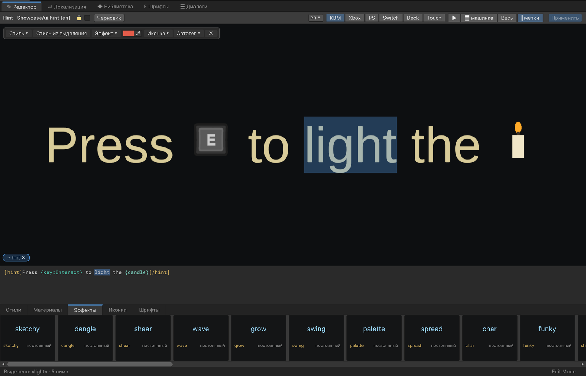

Select a word in the markup field or in the preview itself and a floating bar appears above the text:

| Button | What it does |
| --- | --- |
| **Стиль ▾** (Style) | Wrap the selection in `[style]…[/style]` (library list) |
| **Стиль из выделения** (Style from selection) | Take the tags around the selection (`<color>`, `<b>`, `<i>`, `<u>`, `<cspace>`, `<size>`, an effect) into the new style form |
| **Эффект ▾** (Effect) | Wrap in a TMPEffects effect (`<wave>…</wave>`) |
| colored square | Wrap in `<color=#…>` |
| **Иконка ▾** (Icon) | Insert an `{icon}` from a set |
| **Автотег ▾** (Auto-tag) | Automatically decorate this word with a style everywhere |
| **✕** | Remove all markup from the selection |

The status bar says `Выделено: «light» · 5 симв.` (Selected, 5 chars); the chip at the left of the preview shows the
style that covers the selection, and its ✕ removes it.

### Gallery: styles, icons, effects

The gallery tabs show what can be inserted.

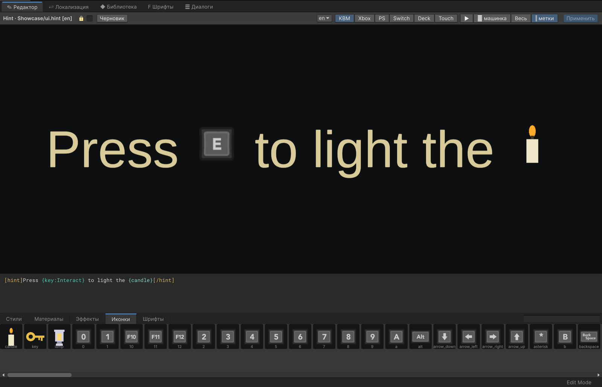

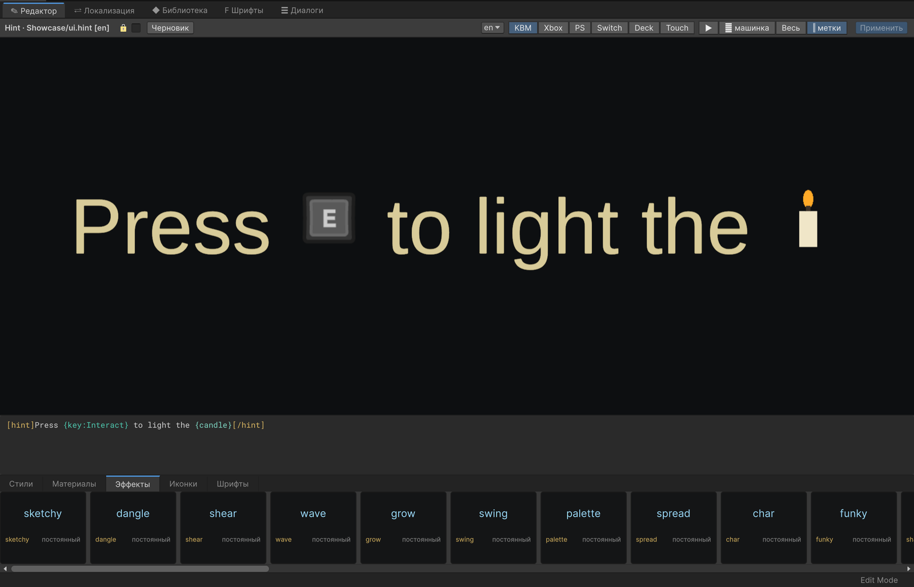

- **Icons** — one card per picture, the caption is the key (`candle`, `key`); `{key}` or `{set/key}` goes into the text.
- **Effects** — built-in TMPEffects animations and your own (marked «свой», custom). The kind is on the card:
  basic `<x>`, show `<+x>`, hide `<-x>`.
- The **+ стиль**, **+ материал**, **+ эффект** cards at the end of the list open the creation forms.
- Right-click a material or effect card — delete (materials and effect assets go to the OS trash; tags in the text stay).

### Task: create a style

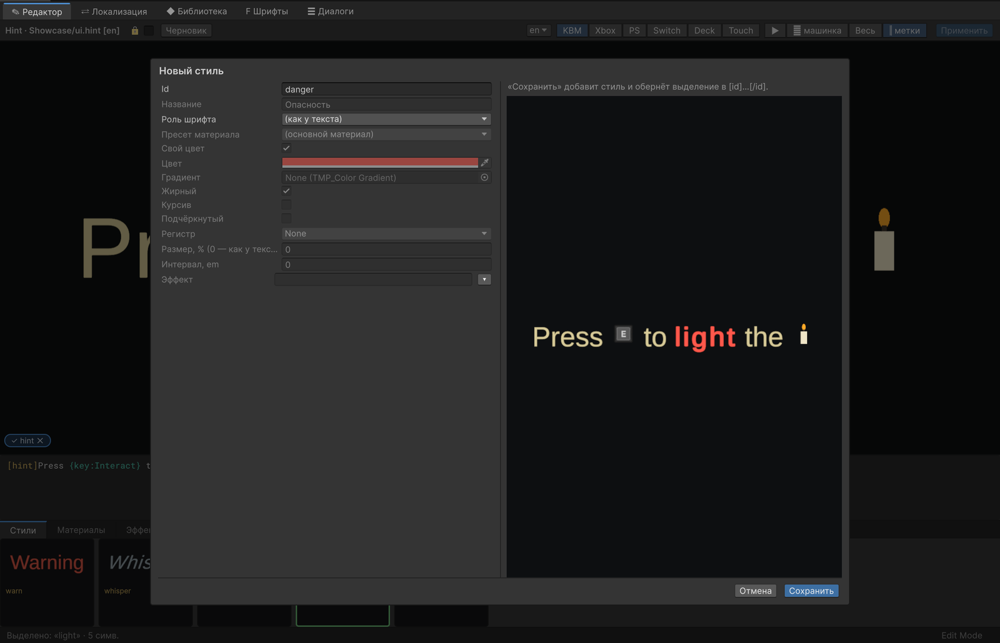

1. In the gallery open **Стили** and click the **+ стиль** (+ style) card (or the **+ стиль** button in the Library tab).
2. Type the **Id** — the tag name (`danger` → `[danger]text[/danger]`). While it is empty or taken, the reason is shown at the
   bottom of the form and «Сохранить» (Save) is unavailable.
3. Set the look: **Название** (display name), **Роль шрифта** (font role) and **Пресет материала** (material preset), **Свой цвет**
   (use color) and **Цвет** (or a **Градиент**), **Жирный / Курсив / Подчёркнутый** (bold / italic / underline),
   **Регистр** (case), **Размер, %** (size), **Интервал, em** (spacing), **Эффект** (effect; ▾ lists TMPEffects).
4. The right side is a live preview on the selected text or on a sample.
5. **Сохранить** adds the style to the `StyleLibrary`; if text was selected in the field it is wrapped in
   `[id]…[/id]`. **Отмена** (Cancel) closes the form without changes.

To make a style from tags that are already placed, select text like `<color=…><b>…` and press
**Стиль из выделения**: the tags move into the form and after «Сохранить» are replaced by a single `[id]…[/id]`.

### Task: create a material preset

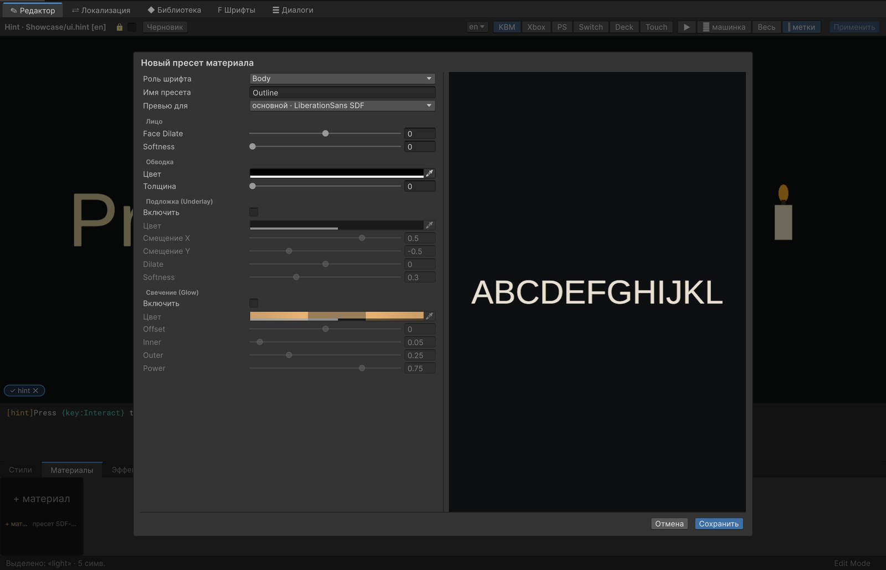

A preset is a variant of the font's SDF material: outline, underlay, glow.

1. Gallery → **Материалы** → **+ материал**.
2. Pick a **Роль шрифта**, a **Имя пресета** (preset name) and the language for the preview.
3. Tune **Face Dilate / Softness**, **Обводка** (outline: color, thickness), **Подложка (Underlay)**, **Свечение (Glow)**.
   Glow exists only in the full shader: a preset with it switches the material to `TextMeshPro/Distance Field`.
4. **Сохранить**: a copy of the material is created **for every font of the role** (each language has its own atlas)
   under one id, so a style that uses this preset works in every language.

### Task: create a custom effect

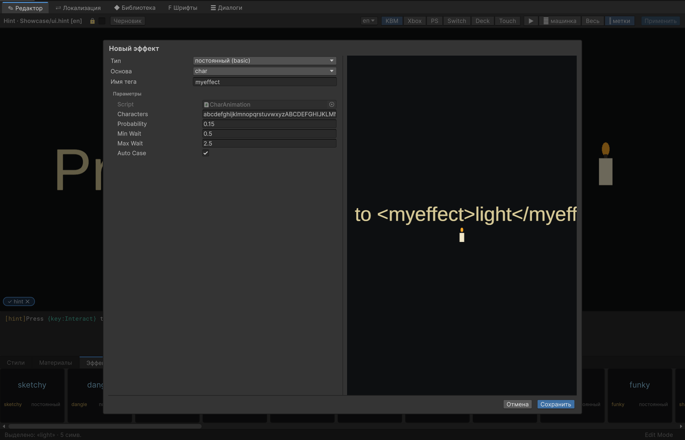

1. Gallery → **Эффекты** → **+ эффект**.
2. **Тип** (kind): basic, show or hide. **Основа** (base) — a copy of a built-in TMPEffects animation,
   `Generic` (tracks) or `Stack` (several animations). **Имя тега** (tag name) — lowercase Latin letters, digits and `_`;
   it must not clash with a built-in effect or a TMP tag.
3. The base's parameters are edited in the "Параметры" block (an asset inspector).
4. **Сохранить**: the effect lands in the project animation database, autocomplete, the gallery, the
   «Эффект ▾» menu and the style effect dropdown.

> In the form preview a tag with a not-yet-saved name shows literally (`<myeffect>…`) — the effect starts
> working after «Сохранить».

### Task: write a word change to the table ("was / now")

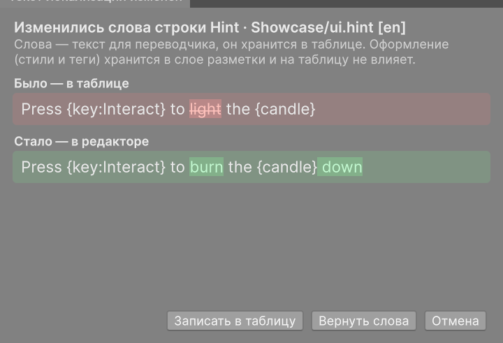

If a table key is open and you **changed the words** (not just the decoration), «Применить» does not write silently: a
"was / now" window opens. It also shows when you switch to another object or close the window with unapplied word changes.

- **Записать в таблицу** (Write to the table) — the table gets the new text without decoration, the layer gets the decoration.
- **Вернуть слова** (Restore the words) — keep the table's words and save only the decoration changes (unavailable when the new
  decoration cannot be mapped onto the old words; the reason is shown under the diff).
- **Отмена** — go back to editing.

If the words did not change, «Применить» writes to the markup layer only.

---

## 3. Localization tab

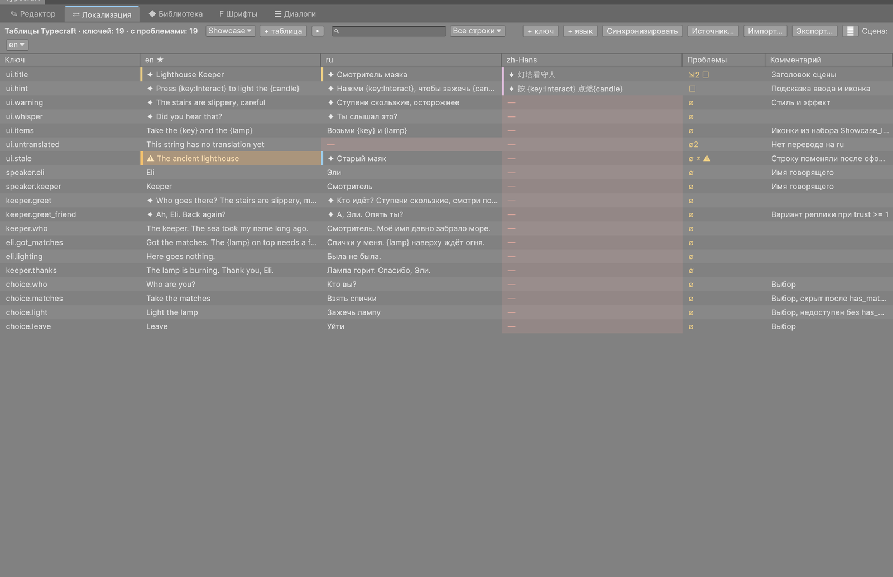

A grid of strings: the key on the left, then a column per language (★ marks the base one), then the **Проблемы**
(Issues) and **Комментарий** (Comment) columns.

**Toolbar.** The string source and a summary (`ключей: 19 · с проблемами: 19` — keys, with issues), the table dropdown and
**+ таблица** (+ table), **▸** (ping the table asset), search, filter, **+ ключ** (+ key), **+ язык** (+ language),
**Синхронизировать** (Sync), **Источник…** (Source…), **Импорт…** (Import…), **Экспорт…** (Export…), **⟳** (recheck all) and
**Сцена:** (Scene) — the language in which scene texts are shown.

**Filters:** *Все строки (all) · Есть проблемы (has issues) · Только изменившиеся (changed only) · Нет перевода (no translation) ·
Не помещается (overflow) · Нет символа в шрифте (missing glyph) · Разметка расходится (markup mismatch)*.

**Marks in cells and in the Issues column:**

| Mark | Meaning |
| --- | --- |
| `—` (red background) / `∅` | Missing translation |
| `⇲` | Overflow (the text is longer than the limit) |
| `□` | The language font has no glyph for a character |
| `≠` | Markup mismatch (`{…}` tokens differ between languages) |
| `✦` | The string has decoration in the markup layer |
| `⚠` | The table string changed — the decoration no longer applies |

The number after a mark (`∅2`) is the count of languages with that issue. The tooltip of a cell explains the cause.

**Quick actions on a key:** double-click — where it is used, **F2** or right-click — rename.

### The cell panel

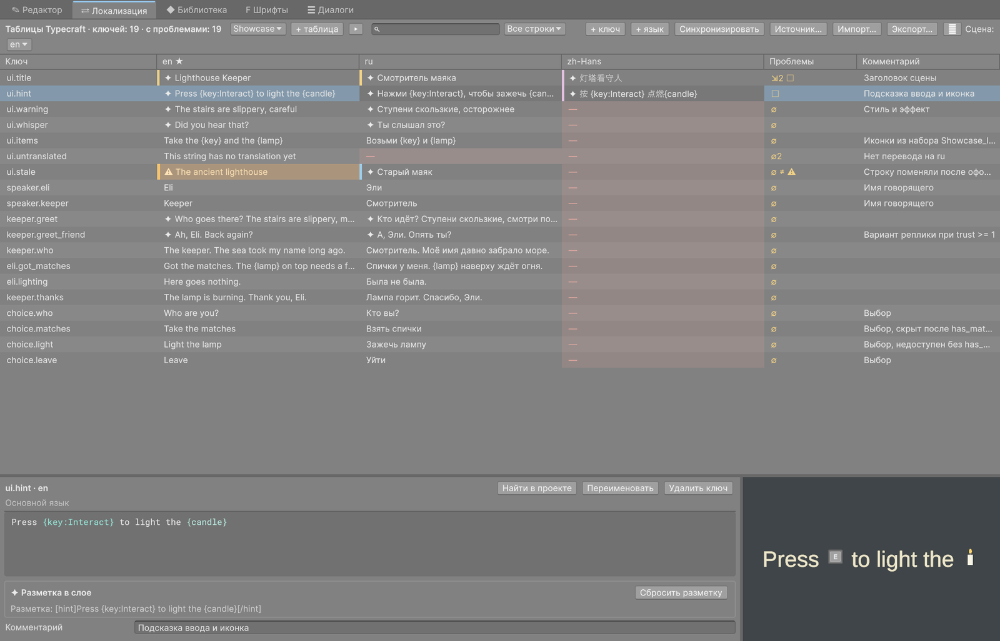

Clicking a cell opens a panel at the bottom: the string field on the left (with markup highlighting and hints), a preview
with the language's real font on the right. Buttons: **Найти в проекте** (Find in project), **Переименовать** (Rename),
**Удалить ключ** (Delete key); below — a **Комментарий** (comment) for the translator. The **✦ Разметка в слое** block shows how the
string is decorated and has the **Сбросить разметку** (Reset markup) button.

### Task: add a key

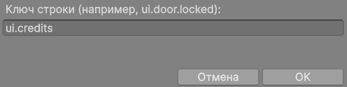

1. Pick a table in the dropdown (no suitable table — **+ таблица**, a name like `UI`, `Dialogues`, `Items`).
2. **+ ключ** → type a name like `ui.door.locked` → **OK**. The key appears selected in the grid.
3. Fill in the base language cell (★), then the others — see the next task.

### Task: translate a string

1. Click the cell of the needed language in the key's row — the panel opens at the bottom.
2. Write the text in the field. Edits go to the table **immediately** and are undone with Ctrl+Z.
3. Put word-order-dependent tokens straight into the text: `{key:Interact}`, `{candle}`, `{0}`. If the base language has a token and
   the translation does not (or vice versa), `≠` appears in the Issues column.
4. The language is not in the grid — **+ язык** (code: `en`, `ru`, `zh-Hans`, `ja`, `pt-BR`…).
5. Decoration (`[style]`, `<tag>`) is not written to the table — it is set in the Editor tab (see above): the table stays clean for translators.

Languages with ideographs show `□` and "нет N" on the Fonts tab until the font is rebuilt for the new strings — see
[the "Build a font" task](#task-build-a-font-for-a-language).

### Task: restore decoration after a string edit

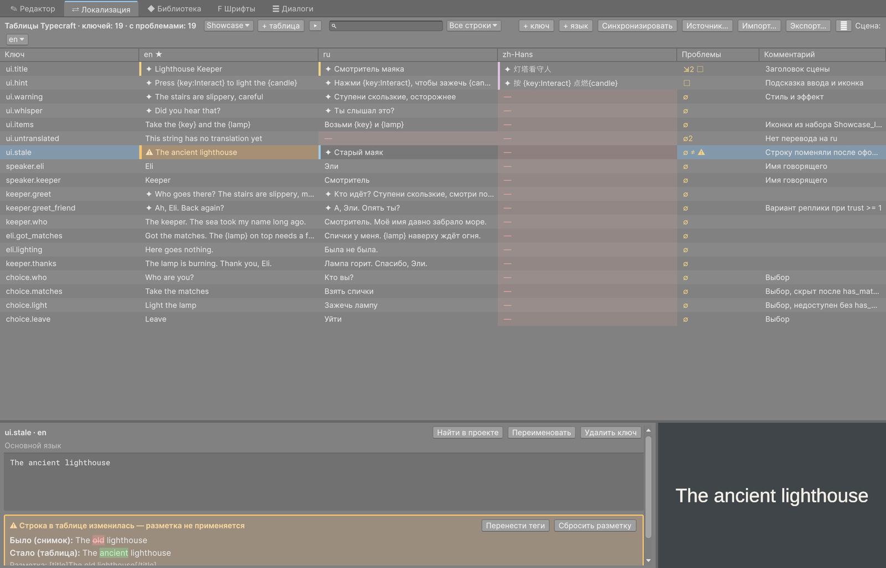

If a translator (or a sync) changed a string that has decoration in the layer, the cell is marked ⚠ and the cell panel shows
"Было (снимок)" (was, snapshot) and "Стало (таблица)" (now, table).

- **Перенести теги** (Transfer tags) — move the decoration onto the new text by matching words. Anything that cannot be mapped exactly is shown and confirmed.
- **Сбросить разметку** — delete the layer entry: the string is shown without decoration.
- The **Только изменившиеся** filter lists all such strings.

### Task: where is a key used

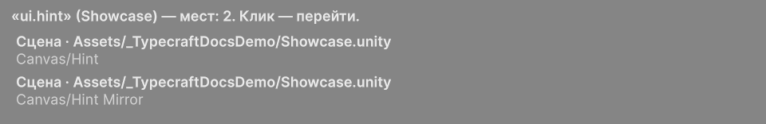

A double-click on a key (or **Найти в проекте**) looks for `TypecraftText` in *Localized* mode in open and closed scenes and prefabs under
`Assets/`, and `"key"` literals in `.cs` files. One place — jumps straight there: the object is selected, a closed scene opens after
the save prompt, a prefab opens in Prefab Mode, a script at the line. Several places — a list; click a row to go there.

### Task: import from Google Sheets, Excel or CSV

A table can live in an external file and be pulled in the editor (there is no runtime sync).

**Format.** The first row is the header: `key` is required, `comment` is optional, the rest are language codes
(`en`, `ru`, `zh-Hans`). Columns that do not look like a language code (`notes`) are skipped.

**One time — "Импорт…".** Pick a `.csv`, `.tsv` or `.xlsx`; a report opens before anything is applied.

**A permanent source — "Источник…".**

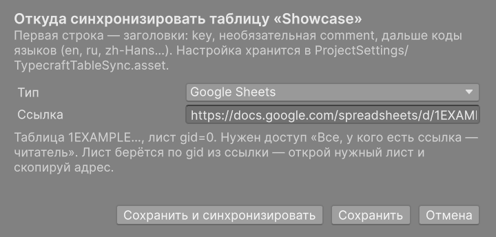

1. Select a table and press **Источник…**.
2. **Тип** (type): *Google Sheets*, *Excel* (`.xlsx`: file and sheet) or *CSV/TSV* (file).
3. For Google Sheets paste a regular link `https://docs.google.com/spreadsheets/d/<SHEET_ID>/edit#gid=<GID>` — the sheet is chosen by `gid`.
   The sheet needs access "Anyone with the link — Viewer" (or "Publish to the web"); a private one gives the "Таблица закрыта" error.
4. **Сохранить** or **Сохранить и синхронизировать** (Save and sync). The source is stored in
   `ProjectSettings/TypecraftTableSync.asset` (editor only, not in builds); the link ends up in the repository, so do not put private sheets there.
5. After that just press **Синхронизировать**. The download runs in the background and can be cancelled with **Отмена**.

**The report before applying.**

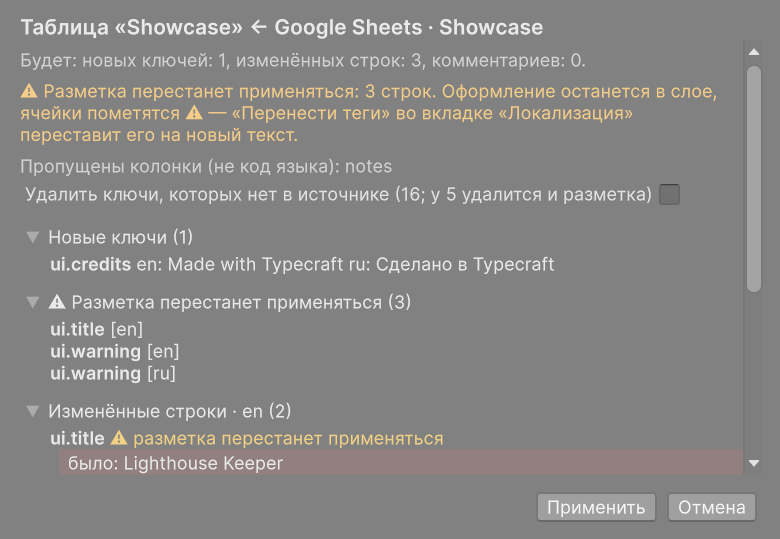

Summary at the top ("new keys: 1, changed strings: 3"), then warnings, switches and sections: **Новые ключи** (new keys),
**Разметка перестанет применяться** (markup will stop applying), **Изменённые строки · язык** (changed strings, with was / now),
**Комментарии**, **Нет в источнике** (missing from the source).

- **Добавить языки** — if the source has languages the project does not.
- **Стирать строки…** — an empty cell in the source does **not** erase a translation by default; the checkbox turns erasing on.
- **Удалить ключи, которых нет в источнике** — off by default; when on, the layer entries of those keys are removed too.
- **Применить** — a single Undo step. After a sync use the **Только изменившиеся** filter and **Перенести теги**.

### Task: export

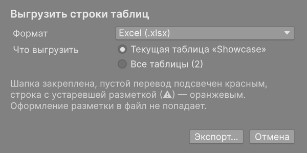

1. **Экспорт…** → **Формат**: Excel `.xlsx`, CSV, TSV or JSON.
2. **Что выгрузить** (what to export): the current table or all of them.
3. **Экспорт…** → choose a file (a folder, one file per table, for CSV/TSV of all tables).

Columns: `key`, `comment` and languages (base first) — the file reads back through sync. In `.xlsx` the header is
frozen, missing translations are red, rows with ⚠ are orange. Layer decoration is not exported.

---

## 4. Library tab

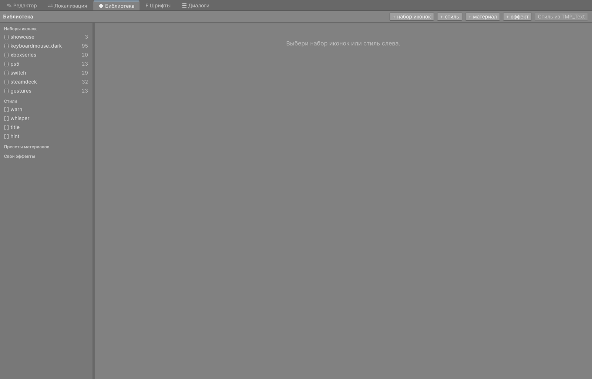

Left — the list: **Наборы иконок** (icon sets, with the picture count), **Стили** (styles), **Пресеты материалов** (material presets),
**Свои эффекты** (custom effects). Right — the editor of the selected item. Toolbar: **+ набор иконок**, **+ стиль**,
**+ материал**, **+ эффект** (the same forms as in the Editor gallery) and **Стиль из TMP_Text** — create a style from the
`TMP_Text` selected in the scene: font, color, size.

### Icon sets

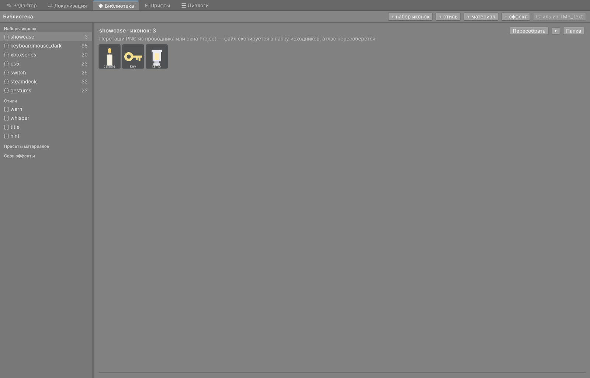

A set is a folder of PNGs from which an atlas and a `TMP_SpriteAsset` are built. A tile is an icon, the caption is its key. Set buttons:
**Пересобрать** (rebuild the atlas from the source folder), **▸** (ping the asset), **Папка** (open the source folder).

#### Task: add an icon set and fit an icon

1. **+ набор иконок** → a name and a parent folder inside `Assets` (not `Resources`: the source PNGs would get into the build).
   A `<name>/Source` folder, the set asset and an entry in `TypecraftSettings` are created.
2. Drag PNGs from the file explorer or the Project window into the set — each file is copied into `Source` and the atlas is
   rebuilt. The icon key comes from the file name.
3. Each picture is checked against the standard — 128×128, the drawing centered, 12 px margins
   ([`ART_RULES.en.md`](ART_RULES.en.md), template [`IconTemplate_128.png`](IconTemplate_128.png)). If something is off, the check opens:

   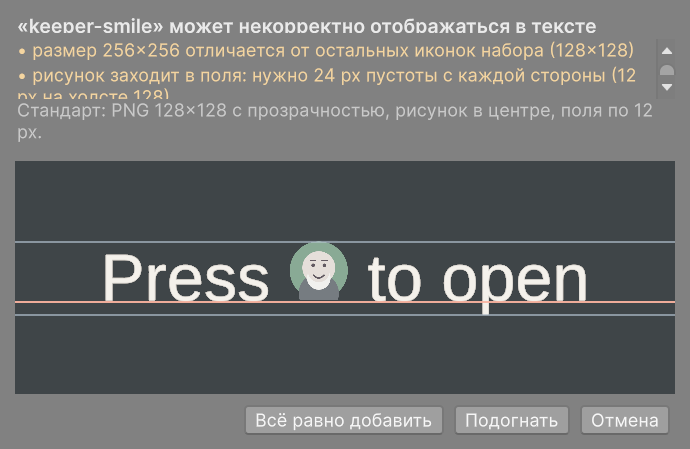

   The preview shows the icon inline with text and the line guides. **Всё равно добавить** (Add anyway), **Подогнать**
   (Fit: add and open the fitting right away) or **Отмена**.
4. Clicking a tile opens the icon panel:

   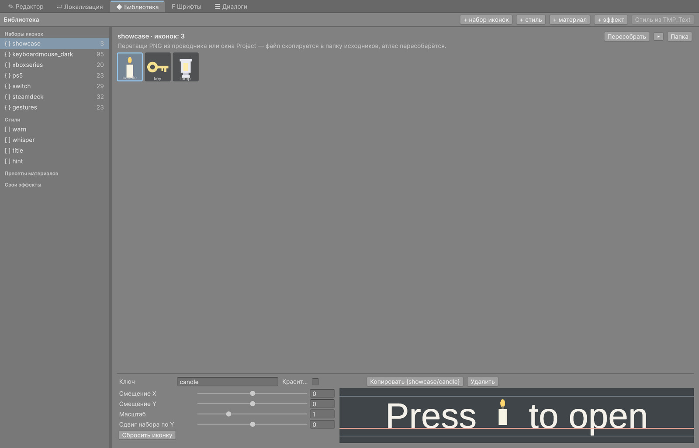

   - **Ключ** — the tag (`{showcase/candle}` includes the set); renaming rewrites the tags in tables, scenes and prefabs;
   - **Смещение X / Y** (offset) and **Масштаб** (scale) — fitting relative to the text line; **Сдвиг набора по Y** — one shift for
     the whole set; **Сбросить иконку** resets to defaults;
   - **Красится цветом текста** (tinted by text color) — the icon takes the surrounding text's color;
   - **Копировать {…}** copies the tag, **Удалить** removes the icon from the set.
   - At the bottom — a preview inside a line of text.
5. No picture for a key? A placeholder tile waits for a PNG with the same name.

### Styles

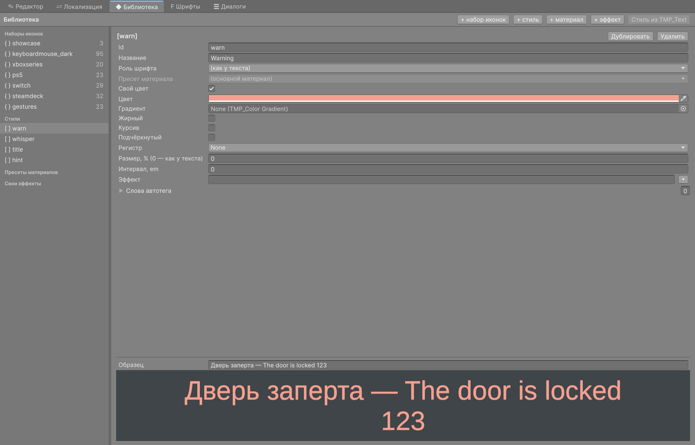

A click on a style opens its fields (the same as in the creation form) and a **sample** with a live preview. **Дублировать**
(duplicate) makes a copy, **Удалить** removes the style. **Слова автотега** (auto-tag words) lists words that this style decorates automatically.
Renaming the **Id** rewrites the tags in layers, tables and scenes (prefabs and closed scenes are saved immediately, without Undo).

### Materials and effects

The **Пресеты материалов** and **Свои эффекты** sections list presets and effects created in the forms; **Удалить** removes the
selected one (materials and effects go to the OS trash, tags in the text stay).

---

## 5. Fonts tab

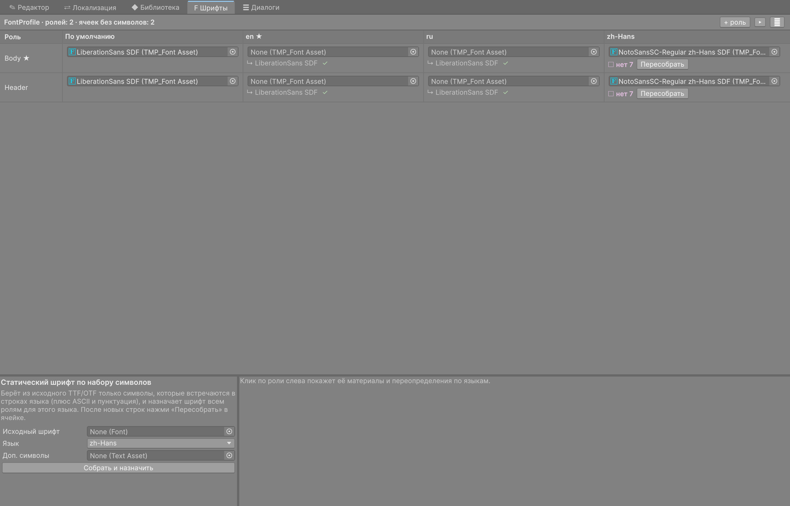

A **roles × languages** table: a "По умолчанию" (default) column and one column per language. A role is a semantic slot (`Body`,
`Header`), ★ marks the default role. A cell holds the language's font for the role; an empty cell inherits
(`↳ LiberationSans SDF ✓` shows the font that will really be used).

Under the cell is the glyph coverage: `✓`, or **нет N** (N characters of the language's strings are missing from the font) with a
**Пересобрать** (Rebuild) button for a static font. The header summary: `ячеек без символов: 2` (cells without glyphs).

**Toolbar:** **+ роль** (new font role), **▸** (ping the profile), **⟳** (recheck coverage).

Click a role name to expand its materials and per-language overrides:

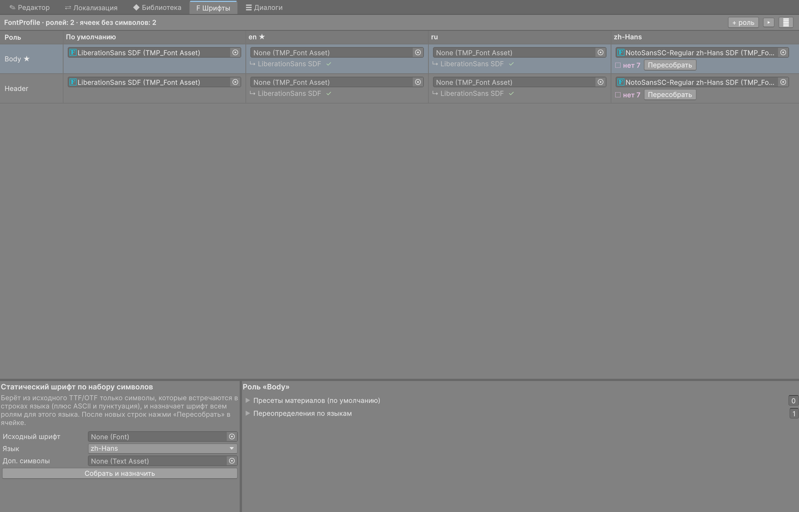

### Task: build a font for a language

This is for CJK and any language with a big alphabet: a static font holds only the characters that occur in the strings and is many times lighter than the full one.

1. In the **"Статический шрифт по набору символов"** (Static font from a character set) block (bottom left) pick the
   **Исходный шрифт** (source font: TTF/OTF; Noto Sans SC works for Chinese) and the **Язык**.
2. Optionally **Доп. символы** — a text file with extra characters that are not in the strings (names, UI).
3. **Собрать и назначить** (Build and assign): the package takes only the needed characters from the source (plus ASCII and
   punctuation), builds a `TMP_FontAsset` and assigns it to all roles of that language.
4. You added strings in that language — the role cell shows **нет N**: press **Пересобрать**. The atlas in the preset
   materials updates by itself.

> In the Showcase sample Chinese exists only for the title and the hint on purpose: in a project that already has a zh-Hans font
> a `нет N` appears next to it — the normal "rebuild needed" state.

---

## 6. Dialogues tab

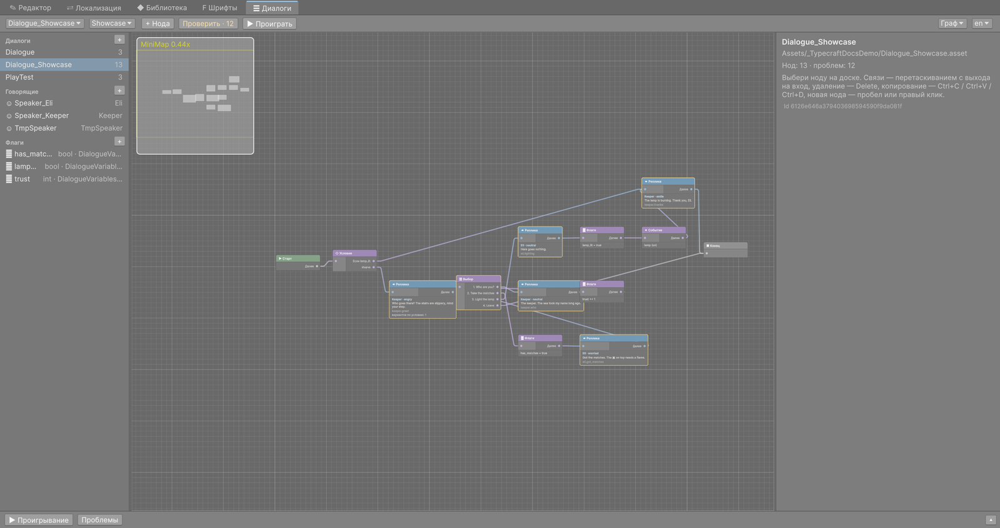

The tab layout:

- **Left** — dialogues, speakers and flags of the project. The number next to a dialogue is its node count.
  The **+** of a section creates a new item (a flag creates a catalog if there is none).
- **Center** — the board. **Graph**: a node is a rectangle, a link is dragged from an output port to an input port,
  Space or right-click adds a node, a minimap is in the top left. Or a **Список** (list) of nodes (the Graph/List switch is at the right of the toolbar).
- **Right** — the inspector of the selected node. With nothing selected it shows the dialogue itself: path, node and issue counts.
- **Bottom** — a panel with the **▶ Проигрывание** (Playback) and **Проблемы** (Issues) pages (collapsible with the arrow on the right).
- **Toolbar** on top: dialogue picker, the default string table, **+ Нода**, **Проверить · N** (Check), **▶ Проиграть** (Play),
  board view and text language.

Pan the board with the middle mouse button and zoom with the wheel; links are dragged from output to input, **Delete** removes,
**Ctrl+C / Ctrl+V / Ctrl+D** copy and duplicate.

**Node types.** Start, **Реплика** (Line: speaker, emotion, key), **Выбор** (Choice: options with conditions),
**Условие** (Branch), **Флаги** (Set Variables), **Событие** (Event), **Ожидание** (Wait), **Переход** (Jump), **Конец** (End) —
details in [README → "Dialogues"](../README.md).

### Task: create a dialogue

1. Dialogues tab → **+** next to "Диалоги" — a new dialogue; the asset appears in the project.
2. Pick the dialogue's **string table** in the toolbar dropdown (`Showcase` in our example).
3. Add nodes: **+ Нода** (on the graph — Space or right-click) → *Реплика*, *Выбор*, *Условие*… Connect ports: drag the dot
   of one node's output onto another's input. Nodes with no incoming link, except Start, are flagged by the check as unreachable.
4. Create **speakers**: **+** next to "Говорящие" → a `SpeakerProfile`. In the asset set the name key, the name style,
   portraits per emotion (`neutral`, `angry`, `smile`…) and the side (*Left/Right*).
5. Create **flags**: **+** next to "Флаги" → name, type (`bool/int/float/string`), default value, description.
6. For each line create a string in the table — see "Создать ключ" below — and check the dialogue.

#### The line inspector

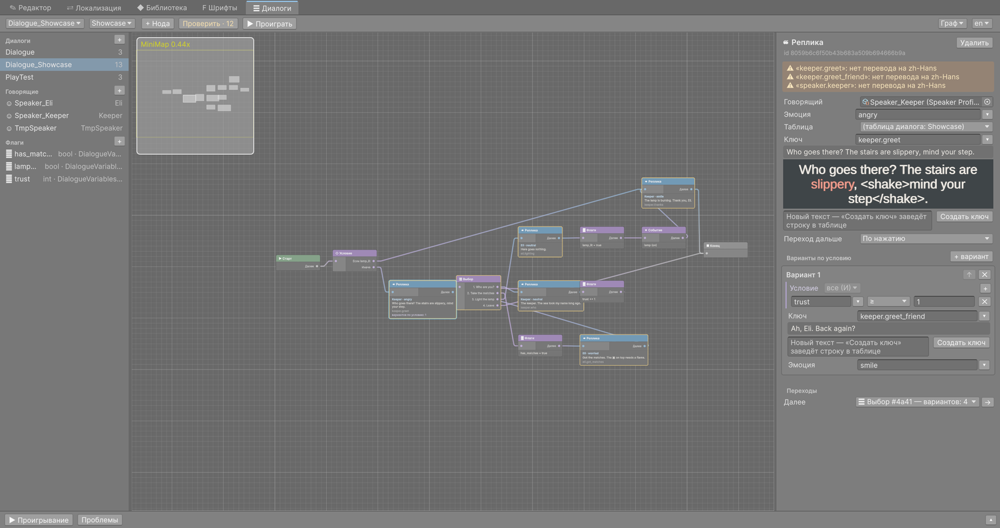

- **Говорящий** (speaker) and **Эмоция** (emotion) come from lists (emotions are taken from the speaker's portraits).
- **Таблица** (table) — the dialogue's table by default; **Ключ** (key) is a searchable field, with the text in the board
  language and a preview with the layer decoration below it.
- **Создать ключ** (Create key) — if the key does not exist, type the text in the base language and press the button: the string
  appears in the table. The `[style]` and `<tag>` decoration from the typed text goes to the markup layer.
- **Переход дальше** (advance) — on input, after N seconds, or after the typewriter + N seconds.
- **Варианты по условию** (variants) — another key and emotion when a condition holds (the first match wins).
- **Переходы** (links) at the bottom — the node "Далее" (Next) leads to (the arrow jumps to it).

### Task: add a choice with a condition

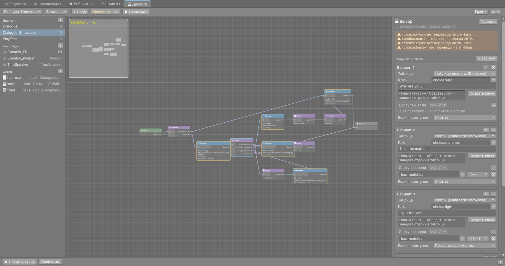

1. **+ Нода → Выбор**; connect its input to the line that offers the choice.
2. In the inspector **+ вариант** (add option): give the **Таблица/Ключ** of the option text.
3. **Доступен, если** (available if) — the condition. Pick a flag from the list, an operator (`истина` true, `ложь` false, `=`, `≠`, `>`, `≥`, `<`, `≤`) and a
   value; several conditions are joined by **все (И)** (all) or **любое (ИЛИ)** (any) — the switch next to the heading.
4. **Если недоступен** (if unavailable): **Скрыть** (hide) — the option is not visible; **Показать неактивным** (disable) — visible, greyed out, not clickable.
5. Connect the option's output port ("N. Title" on the node) to the target node — a line, flags or **Конец** (End).

In Showcase "Take the matches" hides once `has_matches = true`, and "Light the lamp" is grey until the flag is set.

### Task: check a dialogue

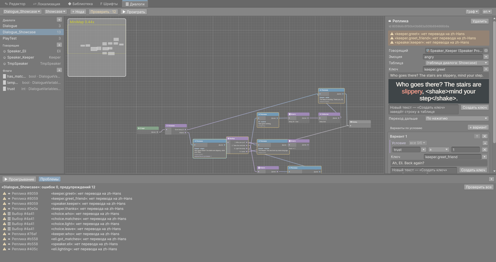

**Проверить · N** (or the **Проблемы** page) shows a list: errors (red) and warnings (yellow). Click a row to select the node. It checks: no start,
empty and broken links, unreachable nodes, an empty or missing key, a missing translation, stale markup, a glyph missing from the
font, an undeclared flag or wrong type, an unknown emotion. **Проверить все** (Check all) runs every dialogue of the project.

Showcase shows 12 "no translation for zh-Hans" warnings here on purpose: this is what the panel looks like, and the game falls back to
the base language when a translation is missing.

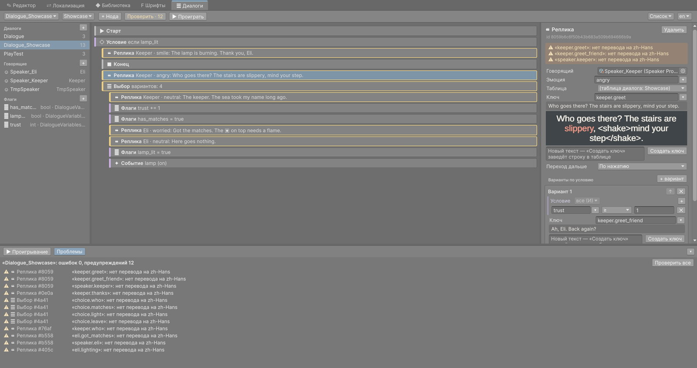

The **Граф / Список** board switch shows the same sequence as a list: handy for long dialogues and when the graph is unavailable
(see ["Without GraphView"](../README.md)).

### Task: play a dialogue without Play Mode

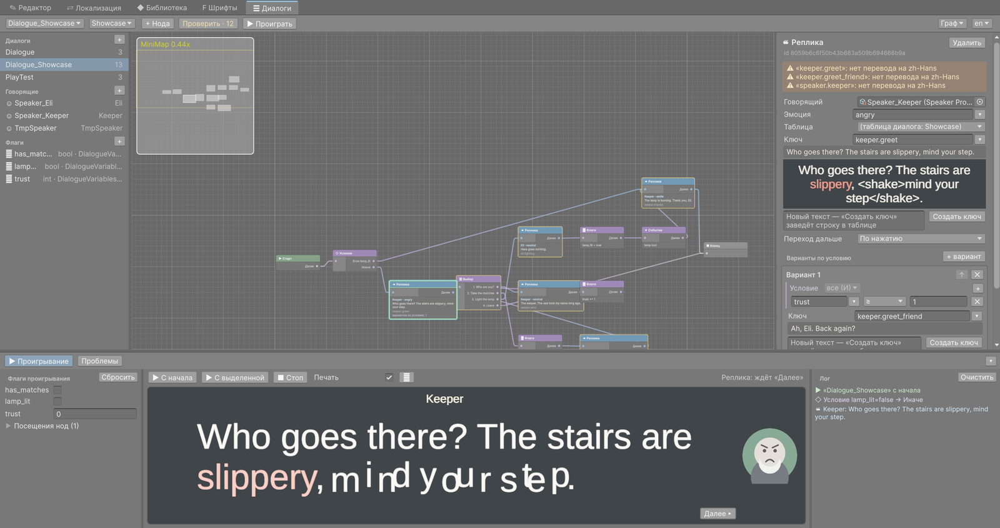

1. The **▶ Проигрывание** page → **▶ С начала** (from start), or select a node and use **▶ С выделенной** (from selected).
2. The line is typed out as in game (**Печать** (typewriter) checkbox; **⟲** replays the line, **Пропустить ожидание** skips the timer).
   **Далее ▸** (Next) or a click moves on; the first press finishes the text.
3. Left — **Флаги проигрывания** (playback flags): change them live and watch the dialogue branch; **Сбросить** resets to the catalog values
   and zeroes visits. Right — the **Лог** (log): nodes, conditions, choices.
4. The current node is highlighted on the board.

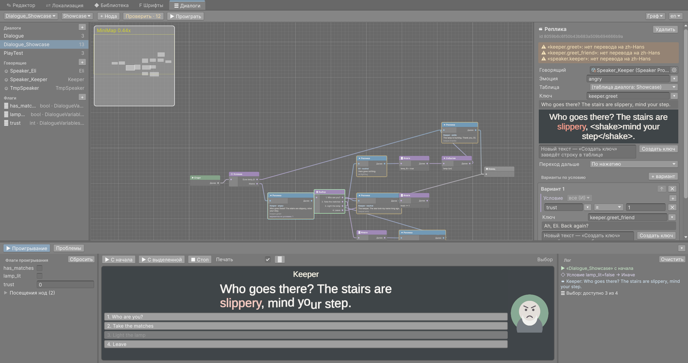

On a choice the options are listed: an unavailable one with the "disable" behavior is grey and not clickable. **■ Стоп** stops playback.

### Task: wire a dialogue into a scene

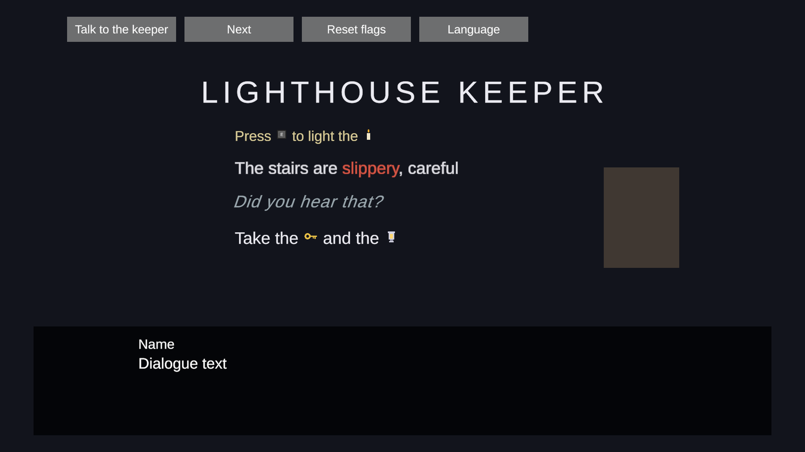

The minimum set of objects: an output (presenter), a player and a trigger.

1. **Output.** `GameObject → Typecraft → Dialogue Box` (a box with portraits and choice buttons), `Subtitles`
   (a `{name}: line` strip) or `World Text` (text in the world). It is created inside a `Canvas` and creates an `EventSystem` when needed.
2. **Player.** Add a `DialoguePlayer` to an empty object and set **Asset** — the dialogue (`Dialogue_Showcase`) and **Presenter** — the output you created.
   If the output has no choices, set a **Choice Presenter**. Turn on `Play On Start` if the dialogue should start at once; `Once` — do not replay.
3. **Start.** Three ways:
   - `Play On Start` on the player;
   - a `DialogueTrigger` component (put it on an object with a trigger collider or anywhere else): the `OnTriggerEnter` mode with a tag
     (for example `Player`), manual `Fire()`, or on start;
   - from code: `player.Play()` (and `Advance()`, `Choose(i)`, `Stop()`).
4. **"Next" input.** For a key or button add a `DialogueInputAdvance` to the player (Input System assembly) and set an `InputActionReference`;
   or call `player.Advance()`.
5. **Flags.** Put the flag catalog into `DialogueGlobals.Catalog` (from a script, as `ShowcaseSample` does) — then flags get their defaults and the Dialogues tab sees the catalog by itself.
6. **Events.** The Event node invokes `DialoguePlayer.OnEvent(name, argument)`. In Showcase `lamp / on` lights the lamp.

More about components and events: [`API.en.md`](API.en.md).

---

## Showcase demo sample

The sample is everything shown in the screenshots: a scene with styles, icons, an input prompt and an effect, a branching
"Lighthouse Keeper" dialogue with a choice and conditions, two speakers with portraits, a flag catalog, its own three-language
string table with a markup layer and its own icon set.

### How to import

1. The project needs a `TypecraftSettings` (`Tools/Typecraft/Create Project Settings`) with the built-in string tables
   (`TableTextSource`). TMPEffects is needed for effects, the Input System for the button glyph.
2. `Package Manager → Typecraft → Samples → Showcase → Import`.
3. `Tools/Typecraft/Samples/Connect Showcase Table` — connects the `Showcase` table to the text source and the markup layer and
   the icon set to `TypecraftSettings`, adds the `en`, `ru`, `zh-Hans` languages. To undo:
   `Tools/Typecraft/Samples/Disconnect Showcase Table`.
4. Open `Showcase.unity` and press Play: **Talk to the keeper**, **Next** or Space (the first press finishes the line),
   **Language** switches the language.

If your project has a bootstrap scene (a DI container that loads its own scenes), pressing Play may load the project's start scene first — start
`Showcase.unity` as the play-mode start scene or load it from code.

### What is inside

| What | Where |
| --- | --- |
| The `Showcase` table: 19 keys, `en`/`ru`, partial `zh-Hans`, comments, a ⚠ string (`ui.stale`), an untranslated string (`ui.untranslated`) | `StringTable_Showcase`, Localization tab |
| Markup layer: styles `title`, `hint`, `warn`, `whisper`, effects `wave`, `shake` | `MarkupLayer_Showcase` |
| The `showcase` icon set (`candle`, `key`, `lamp`) | `Icons/Showcase_Icons`, Library tab |
| An input prompt `{key:Interact}` and an `{candle}` icon in one string | key `ui.hint` |
| The dialogue: a branch on `lamp_lit` (Branch), a four-option choice (**Hide** and **Disable**), a line variant on `trust`, Set Variables and Event nodes | `Dialogue_Showcase`, Dialogues tab |
| Speakers: Eli (left), the Keeper (right, name style `hint`) | `Speaker_Eli`, `Speaker_Keeper` |
| Flag catalog `has_matches`, `lamp_lit`, `trust` | `DialogueVariables_Showcase` |
| Scene glue: buttons, Next, flag reset, language, a lamp driven by the event | `ShowcaseSample.cs` |

### A walk-through of the window

1. **Localization** tab, the `Showcase` table: find the rows with `∅`, `⚠`, `□`; select `ui.stale` and press **Перенести теги**.
2. Select the `Hint` object in the scene — the **Editor** tab shows the hint with a style, a glyph and an icon; switch **KBM / Xbox / PS** to check the glyph.
3. **Library → showcase**: fit the `lamp` icon.
4. **Dialogues → Dialogue_Showcase**: **▶ С начала**, go through the talk, turn `has_matches` on in the playback flags and watch "Light the lamp" come alive.
5. Play: play the dialogue in the scene; the `lamp / on` event lights the lamp.

If keys (`ui.hint`) show instead of text after import, the table is not connected — step 3.

---

## 8. Troubleshooting

| Symptom | Cause and what to do |
| --- | --- |
| A key shows instead of text | The table or the layer is not connected to `TypecraftSettings` (for the sample — `Connect Showcase Table`) |
| No italics, colors or shaking | The markup layer is not connected, or the table string changed: ⚠ → **Перенести теги** |
| Boxes instead of ideographs | The static font was built for other strings: Fonts tab → **Пересобрать** |
| `<wave>` tags show literally in the preview | TMPEffects is not installed; if it is, toggle ❚❚/▶ or reselect the object and the preview refreshes |
| A red `[Interact]` instead of a button | `InputGlyphProfile` has no `Interact` action — change the key to your own action |
| The Dialogues tab opens as a list | The graph assembly (`Editor.Dialogue.Graph`) is missing or the `TYPECRAFT_NO_DIALOGUE_GRAPH` define is on — everything else works |
